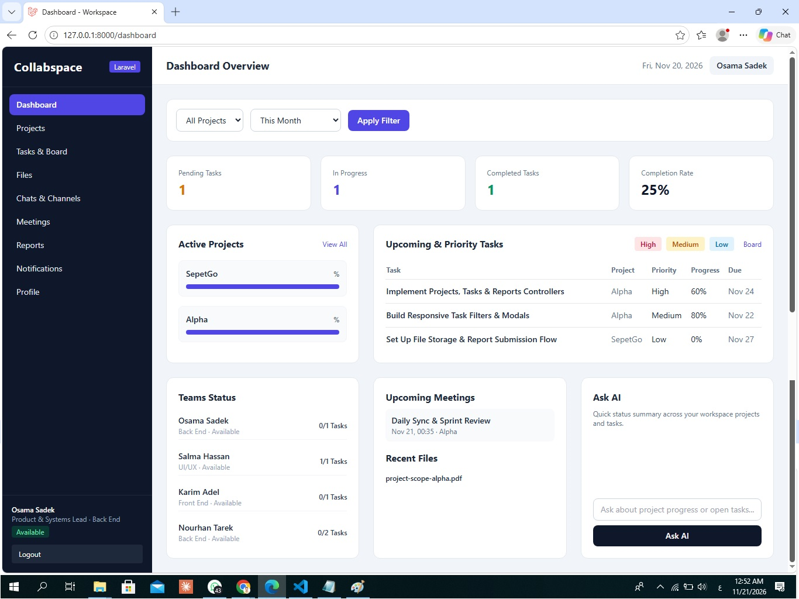

<p align="center"><a href="https://laravel.com" target="_blank"></a></p>

<p align="center">
<a href="https://github.com/laravel/framework/actions"></a>
<a href="https://packagist.org/packages/laravel/framework"></a>
<a href="https://packagist.org/packages/laravel/framework"></a>
<a href="https://packagist.org/packages/laravel/framework"></a>
</p>

# Collabspace Workspace Platform

A collaborative workspace and project management web platform built with **Laravel**, featuring project tracking, task boards, file management, team chats & channels, meetings, daily updates, reports, notifications, and upcoming JSON Business APIs.

## Dashboard Preview



## Local Setup & Quick Start

```bash
composer install
cp .env.example .env
php artisan key:generate
php artisan migrate --seed
php artisan serve
Business APIs Roadmap (In Progress)Projects & Tasks: Manage projects, task statuses, and board updates via JSON endpoints (/api/projects, /api/tasks).Team Collaboration: Files, chats & channels, meetings, and daily updates (/api/files, /api/chats, /api/meetings, /api/daily-updates).Reports, Notifications & Profile: Workspace metrics, reports export/submission, notifications, and user profiles (/api/reports, /api/notifications, /api/profile).About LaravelLaravel is a web application framework with expressive, elegant syntax. We believe development must be an enjoyable and creative experience to be truly fulfilling. Laravel takes the pain out of development by easing common tasks used in many web projects, such as:   Simple, fast routing engine.   Powerful dependency injection container.   Multiple back-ends for session and cache storage.   Expressive, intuitive database ORM.   Database agnostic schema migrations.   Robust background job processing.   Real-time event broadcasting.   Laravel is accessible, powerful, and provides tools required for large, robust applications.   Learning Laravel   Laravel has the most extensive and thorough documentation and video tutorial library of all modern web application frameworks, making it a breeze to get started with the framework. You can also check out Laravel Learn, where you will be guided through building a modern Laravel application.If you don't feel like reading, Laracasts can help. Laracasts contains thousands of video tutorials on a range of topics including Laravel, modern PHP, unit testing, and JavaScript. Boost your skills by digging into our comprehensive video library.Laravel SponsorsWe would like to extend our thanks to the following sponsors for funding Laravel development. If you are interested in becoming a sponsor, please visit the Laravel Partners program.Premium PartnersVehiklTighten Co.Kirschbaum Development Group64 RobotsCurotecDevSquadRedberryActive LogicContributingThank you for considering contributing to the Laravel framework! The contribution guide can be found in the Laravel documentation.   Code of Conduct   In order to ensure that the Laravel community is welcoming to all, please review and abide by the Code of Conduct.   Security Vulnerabilities   If you discover a security vulnerability within Laravel, please send an e-mail to Taylor Otwell via taylor@laravel.com. All security vulnerabilities will be promptly addressed.   LicenseThe Laravel framework is open-sourced software licensed under the MIT license.
